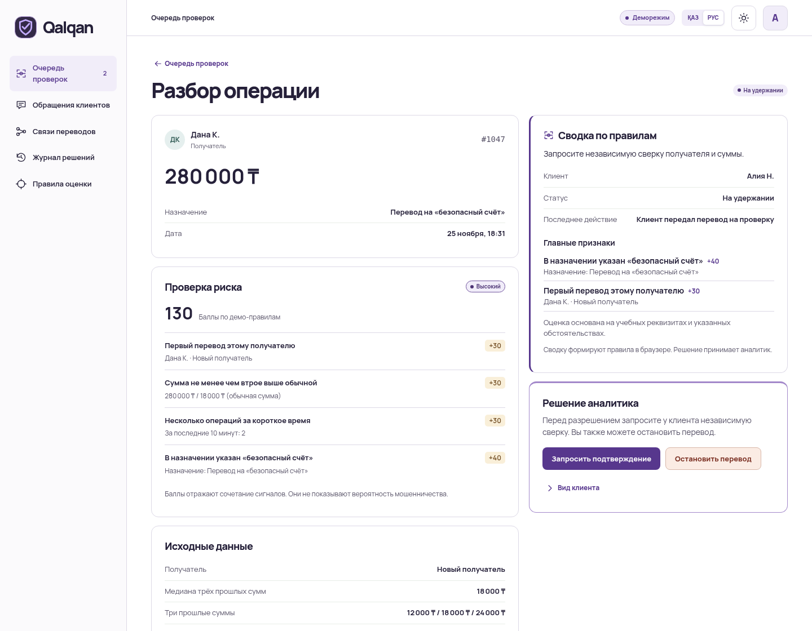
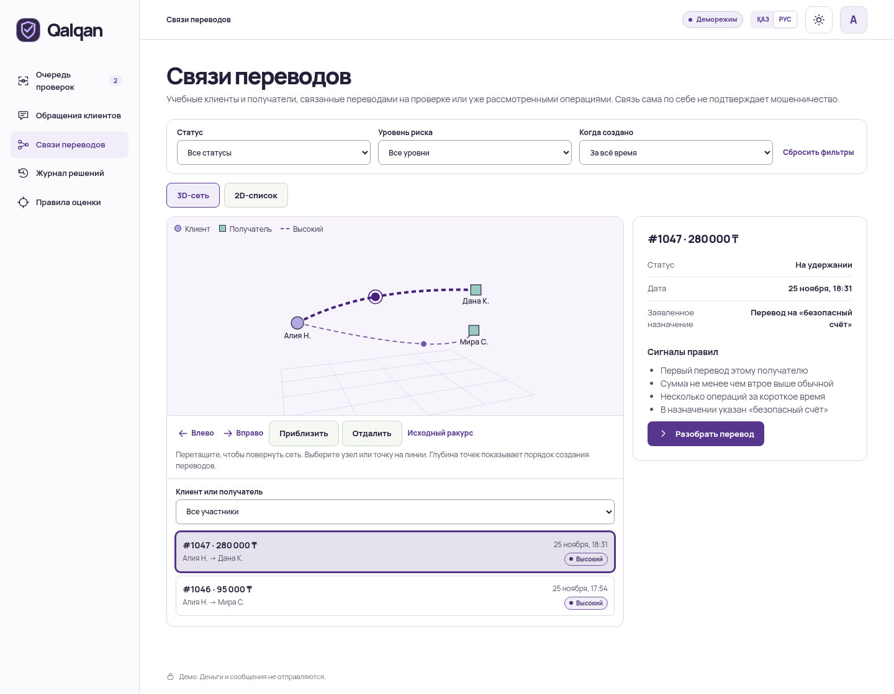
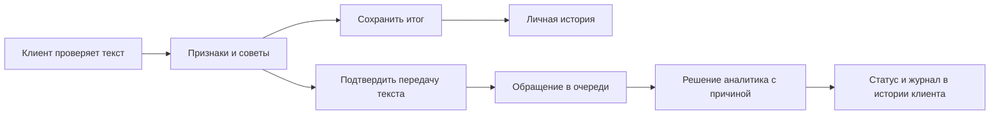

# Qalqan — проверка сообщений и переводов

**ITU HACKATHON-2026 · Финтех-кейс Банка ЦентрКредит.** Qalqan помогает сделать паузу перед ответом на подозрительное сообщение или отправкой денег. Клиент видит конкретную фразу или реквизит, который требует внимания, и может передать его на разбор. Аналитик работает в общей очереди и возвращает клиенту вывод с причиной.

Все имена, сообщения, операции и сигналы вымышлены. Деньги не переводятся, обращения никуда не отправляются, банк не подключён. Прототип рассчитан на показ в одной вкладке.

## Evaluator quick start

Qalqan is a browser MVP for the Bank CenterCredit fintech case. It helps a customer recognize a suspicious request before a simulated transfer, then connects the customer’s report and the analyst’s decision through the same case.

- **Launch.** From the project root, run `python3 -m http.server 4281 --bind 127.0.0.1` and open `http://127.0.0.1:4281/` on that computer. The active entry point is [index.html](index.html). The application runs without a build, account service, or API key.
- **Customer to analyst.** Choose **Клиент** in the entry screen, then use `aliya@qalqan.example`. Start a suspicious transfer or check a sample message, send it for review, and open the analyst view with `arman@qalqan.example`. Record a decision, then return to the customer view and check the case history.
- **Public release.** Target [beriknurull7/ITU-HACK2](https://github.com/beriknurull7/ITU-HACK2), default branch `main`. The local MVP and offline build are available for review. A public HTTPS demo link will be added once it can be opened and checked without signing in.

| Case evidence | Transfer network |
|---|---|
|  |  |

## Как устроен продукт

Обращение или перевод на проверке имеет один номер в обоих пространствах. По нему клиент и аналитик могут открыть соответствующую карточку и увидеть события, относящиеся к этой записи.

| Пространство | Что можно сделать |
|---|---|
| Клиент | Проверить текст или запись через ручную расшифровку, сохранить итог, передать сообщение на разбор, оценить перевод, ответить на запрос сверки, открыть историю |
| Сотрудник / аналитик | Найти и отсортировать записи, сверить признаки с исходными данными, открыть связи получателя, добавить заметку, запросить подтверждение и записать решение |
| Общая запись | Содержит номер, владельца, текущий статус и журнал. У перевода журнал может включать способ сверки и историю исправлений |

## Как показать за три минуты

1. Выберите **Клиент**, затем войдите как **Алия Н.** (`aliya@qalqan.example`). В этом профиле уже есть четыре учебных перевода. Чтобы начать с пустой историей, нажмите **Зарегистрироваться** и введите вымышленное имя и адрес на `@qalqan.example`.
2. На главной нажмите **Разобрать пример**. В учебном сообщении от «службы безопасности банка» выделены конкретные фразы. Выберите признак, чтобы перейти к нему в тексте. **Сохранить итог** оставляет в личной истории дату и категории. **Передать на разбор** создаёт отдельное обращение с вымышленным текстом.
3. В обращении нажмите **Вид аналитика** и войдите как **Арман С.** (`arman@qalqan.example`). Откроется то же обращение. Сопоставьте сводку по правилам с текстом и запишите решение с причиной. Нажмите **Вид клиента** и войдите в исходный профиль. Проверьте статус и причину в журнале.
4. Откройте **Проверить перевод** и выберите **Неоднозначный**. Под полем получателя появится совет о первом переводе. Перейдите к проверке, выберите способ сверки и отметьте совпадение суммы и получателя. Для подозрительного сценария передайте перевод на проверку. В роли аналитика можно запросить сверку, оставить удержание или остановить симуляцию.
5. В роли аналитика откройте **Связи переводов**. Выберите точку на линии или строку перевода. Посмотрите сумму, время и признаки, затем нажмите **Разобрать перевод**. В карточке откройте связанный случай или **Ход дела в 3D**. Подтвердите запрос сверки и найдите действие в **Журнале решений**.

**Голосовая запись.** В режиме записи можно записать до 45 секунд или открыть аудиофайл до 8 МБ. Прослушайте запись и введите текст вручную. Браузер запрашивает разрешение на микрофон при работе через localhost или HTTPS. При отказе можно открыть файл или продолжить текстом. Аудио остаётся в памяти вкладки, пока открыта студия. Распознавание речи не подключено.

### Демо-профили и оформление

- На входе выберите **Клиент** или **Сотрудник / аналитик**, затем введите имя существующего профиля или его учебный email. Поле подсказывает сохранённые адреса этой роли. При переходе из карточки указывается номер дела. Клиенту подставляется адрес владельца, если он есть в браузере.
- Для регистрации выберите **Зарегистрироваться**. Придумайте имя и уникальный адрес вроде `aisha@qalqan.example`. Форма проверяет обязательные поля, допустимые символы, домен и совпадения с уже созданными профилями. После регистрации появится подтверждение, и откроется соответствующее рабочее пространство. Новый профиль клиента начинает с пустой историей.
- В меню профиля доступны **Настройки профиля**, **Сменить профиль** и **Выйти**. При переименовании адрес, внутренний идентификатор и история сохраняются. В журнале остаётся имя, под которым было выполнено действие. После перезагрузки восстанавливается выбранный профиль и последнее доступное окно. Выход очищает текущий вход и черновики.
- Начальная тема — белая **Светлая**. Кнопка с иконкой оформления открывает три варианта. **Системная** следует настройке устройства. Ручной выбор сохраняется. Меню доступны через Tab и Enter и закрываются по Escape. Системная настройка уменьшения движения отключает переходы интерфейса и плавное перемещение 3D-камеры.
- **Сбросить демо** очищает переводы, обращения и итоги выбранного клиента после подтверждения. Для Алии восстанавливаются четыре исходных перевода. Профили и оформление сохраняются.

Демо-вход открывает учебные записи одного браузера. Адреса `@qalqan.example` вымышлены и почта на них не отправляется. Доступность вкладок определяется ролью, история клиента проверяется по владельцу записи. У любого пользователя этого браузера есть доступ к выбору демо-профиля. Серверной проверки личности, полей пароля, восстановления доступа и Google OAuth в этой версии нет. Для банковского запуска понадобятся серверные роли, защищённые сессии и хранилище.

### Четыре сценария перевода

| Пример | Что увидит клиент | Что попробовать |
|---|---|---|
| Обычный | Али, 12 000 ₸, знакомый получатель, 0 баллов | Проверьте реквизиты и подтвердите. В истории появится завершённый демоперевод на 12 000 ₸. |
| Подозрительный | Дана, 280 000 ₸, четыре сигнала, 130 баллов | Отмените или передайте аналитику. Проверьте запрос ответа и удержание. |
| Неоднозначный | Асель, 22 000 ₸, новый получатель, 30 баллов | Укажите способ связи и подтвердите совпадение суммы и получателя. Можно отказаться или обратиться за проверкой. |
| Ложная тревога | Мира, аренда 95 000 ₸, два недавних перевода, 60 баллов | Правила требуют паузы и для запланированного платежа. Аналитик выбирает причину ложной тревоги и разрешает демоперевод. Клиент увидит выбранную причину рядом с итоговым статусом. Метка сценария сама решения не принимает. |

**Контрольный эксперимент.** В подозрительном примере измените получателя на Али, сумму на 12 000, назначение на помощь семье, историю на редкие переводы. После повторной проверки баллы упадут со 130 до 0. Откройте **Что изменилось** в журнале. Запись покажет старые и новые значения и изменение баллов. Неизменённый повторный просмотр не создаёт новую запись.

## Запуск, резервный показ и HTTPS

Основной файл — [index.html](index.html) в корне репозитория. Он загружает рабочие модули из `src/` и стили из `assets/`. HTML-файлы, созданные через `tools/package_demo.py`, подходят для резервного показа. Прежние локальные копии вида `new18.html` не входят в публикуемую версию.

Приложению нужен современный браузер с JavaScript. Установки зависимостей, API-ключей и сборки для разработки нет. Из корня проекта выполните:

```sh
python3 -m http.server 4281 --bind 127.0.0.1
```

На этой же машине откройте `http://127.0.0.1:4281`. CSS, шрифт и скрипты находятся в репозитории. Для показа без интернета на ноутбуке удобнее подготовить **один HTML-файл**:

```sh
python3 tools/package_demo.py ../qalqan-event/index.html
python3 -m http.server 4174 --bind 127.0.0.1 --directory ../qalqan-event
```

Откройте `http://127.0.0.1:4174` на ноутбуке. Запись файла требует нового пути вне checkout. Наружу не запрашиваются даже шрифты. Прямой доступ по `file://` закрыт политикой Chromium в этой среде, поэтому проверенный резервный путь использует локальный HTTP.

**Статический релиз.** Для загрузки на хостинг нужны `index.html`, `src/` и `assets/`. Для исходного репозитория добавьте README, актуальные изображения `docs/release-*.png`, `checks/` и `tools/package_demo.py`. После публикации откройте итоговый HTTPS-адрес в чистом браузере без входа в хостинг. Пройдите проверку подозрительного перевода и обращения, включая решение аналитика и обновление истории клиента. Добавляйте в README только проверенный публичный адрес.

## Рабочие сценарии

### Сообщение от текста до ответа аналитика

1. Клиент выбирает **Проверить сообщение** или нажимает **Разобрать пример** на главной. Для своей проверки он вводит вымышленный текст от 12 до 6 000 символов.
2. Результат показывает уровень риска, конкретные фрагменты текста и совет по каждому признаку. Нажатие на признак переводит фокус к соответствующей фразе.
3. **Сохранить итог** добавляет личную запись с датой и признаками. **Передать на разбор** открывает подтверждение передачи исходного текста и создаёт обращение со статусом **На разборе**.
4. Аналитик находит обращение по номеру, читает текст и сводку, выбирает **Даны рекомендации** или **Данных недостаточно** и указывает причину. В истории клиента сохраняются итог, причина и события журнала.
5. Из результата проверки можно также открыть форму перевода. В неё подставляются выявленные обстоятельства, которые клиент может проверить и изменить. Получателя и сумму он указывает сам.



### Перевод от оценки до решения

1. Клиент выбирает получателя, сумму, назначение и учебную историю операций. После выбора нового получателя появляется совет свериться с ним по знакомому номеру. **Проверить детали** открывает сумму, получателя, баллы и причины оценки до подтверждения.
2. При низком риске клиент может завершить демоперевод сразу. При среднем риске он указывает способ сверки и подтверждает совпадение получателя и суммы. При высоком риске доступны исправление, отмена или передача на проверку.
3. **Передать на проверку** ставит перевод на удержание и добавляет его в очередь. Аналитик сверяет детали и журнал, затем выбирает действие, доступное в текущем статусе. Сводка показывает возможный следующий шаг.
4. После запроса аналитика клиент может подтвердить совпадение, сообщить о несовпадении, отложить сверку или сообщить, что он не собирался переводить деньги. Ответ возвращается в ту же запись. Если реквизиты различаются, клиент может отменить исходный перевод и открыть новую форму с очищенными спорными полями.
5. Когда условия выполнены, аналитик может разрешить перевод или отметить ложную тревогу. Остановка, разрешение и ложная тревога требуют указать причину, которую клиент увидит в итоговой записи.

| Текущий статус | Что меняет статус |
|---|---|
| **К подтверждению** | Клиент подтверждает после нужной сверки, отменяет или передаёт на проверку |
| **На удержании** | Аналитик открывает запрос сверки, останавливает или разрешает операцию при выполнении условий. Клиент может отменить перевод |
| **Нужен ответ** | Совпадение переводит запись в **Ответ получен**. Отложенная сверка или несовпадение возвращают её на удержание. Отказ клиента признать перевод останавливает его |
| **Ответ получен** | Аналитик разрешает, отмечает ложную тревогу, оставляет на удержании или останавливает. Клиент может отменить перевод |
| **Завершён**, **Отменён**, **Остановлен** | Итог и журнал доступны для просмотра. Исправленный перевод проходит новую проверку |

### Навигация, очередь и журнал

| Что нужно сделать | Где открыть |
|---|---|
| Проверить перевод или подозрительный текст | **Проверить перевод** или **Проверить сообщение** в клиентском меню |
| Посмотреть свои обращения или получить подсказку | **История → Мои обращения** или раздел **Помощь** |
| Найти перевод, проверить признаки, запросить сведения | **Очередь проверок** → карточка дела |
| Найти обращение по сообщению | **Обращения клиентов**. Поиск и фильтры показывают только обращения |
| Посмотреть связанные переводы | **Связи переводов** или ссылка из карточки получателя |
| Проверить, кто и когда принял решение | **Журнал решений**. Поиск по номеру, автору и действию открывает исходное дело |
| Сравнить пороги риска | **Правила оценки**. Выберите сценарий, укажите два порога и нажмите **Сравнить оценку** |

- **Очередь проверок** объединяет переводы, переданные на проверку, и обращения по сообщениям. Поиск работает по номеру, имени клиента и получателю. Фильтры охватывают статус, уровень риска и дату создания. Сортировка доступна по приоритету, новизне, давности и уровню риска.
- **Карточка перевода** показывает поля учебной формы, снимок предыдущих операций, найденные признаки, заявленное назначение и сведения, которых ещё не хватает. Под полем **Связанные переводы** можно открыть записи с тем же получателем или другими получателями этого клиента. Эти связи следуют из демоданных, а заявленное назначение берётся из формы.
- **Заметки аналитика** сохраняются у перевода или обращения с именем автора и временем. Клиент видит итог, причину и журнал решения. Заметки отображаются в рабочем пространстве сотрудника.
- **Журнал** показывает создание записи, предупреждения при оценке нового или исправленного перевода, запрос сверки, ответ и решение. Для новых действий сохраняются время и имя из активного профиля. Сотрудник подтверждает запрос уточнения и возврат на удержание с выбором причины. Причина и канал сверки, если он указан, доступны в журнале дела. Источник перевода при этих действиях сохраняется. Для записей прошлой версии имя может отсутствовать.
- **Вид аналитика** и **Вид клиента** ведут через выбор профиля и открывают ту же запись. При возврате в клиентскую роль выберите владельца записи. История клиента показывает его переводы, обращения и личные итоги.

### Связи переводов

1. Откройте **Связи переводов** в меню аналитика. Круг обозначает клиента, квадрат — получателя. Каждая линия соответствует одному учебному переводу, переданному на проверку. Штриховая линия отмечает высокий риск по правилам. В сеть входят и закрытые случаи.
2. Сузьте выборку по статусу, риску или периоду. Выберите узел или участника в списке, чтобы найти его переводы. Выберите точку на линии или строку перевода, чтобы увидеть сумму, дату и время, статус, заявленное назначение и признаки. Из этой карточки можно открыть дело.
3. Перетащите 3D-вид, чтобы изменить ракурс. Кнопки поворота, масштаба и сброса управляют тем же видом. Когда фокус на графике, стрелки поворачивают камеру, + и − меняют масштаб, Home возвращает исходный ракурс. Точки размещены по глубине в порядке создания переводов в текущей выборке. Расстояние между точками не выражает прошедшее время.
4. В режиме **2D-список** можно с клавиатуры выбрать участника и перевод, прочитать детали и открыть дело. На узких экранах список открывается по умолчанию. При недоступности Canvas приложение переключается на список.

Для показа повторной связи передайте на проверку два подозрительных демоперевода одному получателю. В деле откройте **Показать связи получателя** и сравните записи по времени и признакам. Сеть строится из локальной очереди. Её связи отражают записи учебных переводов, а мотив отправителя остаётся неизвестным.

### Ход дела в 3D

Откройте любой перевод или обращение с несколькими событиями и нажмите **Ход дела в 3D** в журнале. Точки идут по порядку действий. Линия связывает их, форма точки различает участника, а глубина показывает этап от создания до итога. Выберите точку мышью или событие в списке, чтобы узнать точное время, автора и причину. На телефоне используется обычный журнал. В обоих режимах данные берутся из того же журнала, который обновляется после ответа клиента или решения аналитика.

## Что проверяет Qalqan

### Сообщения

В браузере работают восемь правил для русского и казахского языков. Они ищут срочность, «безопасный счёт», просьбу сообщить код, адрес сайта, представление от имени банка, просьбу о секретности, угрозу блокировкой и просьбу отправить деньги. В результате выделяются исходные слова. Критические совпадения меняют рекомендацию на паузу. Адреса остаются текстом. Прототип не открывает ссылки, не определяет отправителя и не оценивает репутацию сайтов.

Дополнительное сравнение использует коэффициент Дайса по тройкам букв и маленький набор учебных сообщений. Оно показывает близкий пример при достаточном совпадении. Уровень сигнала, решение аналитика и разрешение перевода от этого сравнения не зависят. Внешнего провайдера ИИ, сетевой передачи и распознавания аудио нет.

Текст проверки остаётся в текущей вкладке. **Сохранить итог** записывает категории и дату без текста в `qalqan.summaries.v1`. **Передать на разбор** отдельно сохраняет вымышленный текст и журнал в `qalqan.reports.v1` после подтверждения. Аудио в эти хранилища не попадает. Реальные SMS, банковские данные и коды в демо вводить не следует.

### Переводы

Перед подтверждением модель берёт снимок учебной активности. Обычные прошлые суммы равны 12 000, 18 000 и 24 000 ₸, медиана — 18 000 ₸. Учебная серия переводов произошла либо 360, 150 и 40 минут назад, либо 42, 7 и 2 минуты назад. Выбранный профиль истории остаётся фиксированным при повторном показе. Новые записи демонстрации сохраняются отдельно от этого эталона.

| Наблюдение | Правило | Баллы |
|---|---|---:|
| Получатель | В профиле ещё не было переводов этому адресату | +30 |
| Сумма | Не меньше трёх медиан, включая ровно 54 000 ₸ | +30 |
| Частота | Не менее двух предыдущих операций за 10 минут | +30 |
| Назначение | Клиент выбрал перевод на «безопасный счёт» | +40 |
| Сообщение клиента | Клиент сам отметил, что его просят сообщить код из SMS | +60 |

Дополнительные условия выбираются вручную. Дистанционная просьба добавляет 20 баллов; срочность, представление сотрудником банка, обещание дохода и текущий звонок добавляют по 30; секретность — 40; показ экрана — 60. Камера, телефонные вызовы и состояние устройства не отслеживаются. Переход из разбора сообщения подставляет предполагаемые обстоятельства. Получатель и сумма остаются пустыми.

Баллы суммируются в диапазоне 0–430. При 0–29 баллах клиент может подтвердить после просмотра. При 30–59 нужно выбрать способ сверки и подтвердить, что получатель и сумма совпали. От 60 прямое подтверждение закрыто. При любом уровне можно исправить детали, отменить операцию или передать её на проверку. После удержания завершение требует решения аналитика. Если речь о «безопасном счёте», запросе SMS-кода, показе экрана или аналитик уже запросил сверку, для разрешения требуется ответ с подтверждением совпадения. Если клиент не смог сверить данные, операция возвращается на удержание. Если клиент не смог связаться, аналитик может повторить запрос или остановить перевод. Если клиент сообщил, что получатель или сумма не совпали, для исходной записи закрыты и разрешение, и новый запрос. При отмене с исправлением спорные поля новой формы очищаются, а оценка рассчитывается заново. Для разрешения, ложной тревоги и остановки аналитик выбирает причину из учебного списка. Отказ клиента признать перевод и остановка аналитиком окончательны для этой записи. При остановке аналитиком причина обязательна и сохраняется в журнале.

Это объяснимые эвристики. Баллы не калиброваны как вероятность. Отсутствие сигнала не гарантирует безопасность, а высокий балл не доказывает мошенничество. Способ сверки и совпадение реквизитов — сообщения клиента в рамках демонстрации. Приложение не подтверждает, что связь состоялась. Приложение не проверяет звонки, устройство, личность или реквизиты и не просит вводить одноразовый код.

### Песочница правил

В **Правилах оценки** приведены веса, которые использует MVP. Можно выбрать обычный, подозрительный, неоднозначный сценарий или ложную тревогу и сравнить рабочую классификацию с пробными порогами. Сравнение использует ту же сумму баллов. Пороги песочницы действуют только в этом расчёте и не меняют карточки, очередь, решения или исходные правила. Пробные значения остаются в памяти вкладки.

### Помощник аналитика

**Сводка по правилам** помогает аналитику выбрать, что проверить сначала. Для перевода она показывает два признака с наибольшим вкладом в балл и приводит данные формы или учебной истории. Для обращения она ставит просьбу сообщить код и перевести на «безопасный счёт» выше срочности или ссылки и цитирует найденные фразы. Если совпадений нет, предлагает уточнить контекст.

Сводка отдельно указывает ограничения. Например, фраза не подтверждает личность отправителя, а ответ о сверке записан со слов клиента. Следующий шаг зависит от статуса дела. Расчёты выполняются в браузере по правилам без LLM, внешнего API и передачи данных. Решение принимает аналитик, открыв исходную запись и журнал.

## Архитектура и языки

| Файл | Ответственность |
|---|---|
| `src/message.js` | Правила и подсветка, локальное сравнение, модели сохранённого итога и обращения. |
| `src/voice.js` | Микрофон, остановка записи, локальное воспроизведение и очистка объекта аудио. |
| `src/model.js` | Учебная история, валидация перевода, баллы, условия разрешения, ответы и снимки при правках. Обе роли используют одну запись и один механизм переходов. |
| `src/app.js` | Экран входа, регистрация, навигация по ролям, переход к той же записи, формы, история и очередь. |
| `src/workspace.js` | Локальные профили и миграция прежних профилей, проверка маршрута и владельца, восстановление сеанса, выбор темы и приоритет признаков в сводке по правилам. |
| `src/network.js` | Поиск связанных переводов, разметка сети и хода дела, перспективная проекция на Canvas, поворот, масштаб и выбор события или перевода. |
| `src/locale.js` | Парные казахские и русские строки, включая состояния, ошибки, сигналы, советы и события журнала. Валюта — ₸, время — Asia/Almaty. |
| `index.html`, `assets/` | Статический интерфейс, адаптивные стили и локальный шрифт Manrope с лицензией OFL. |
| `tools/package_demo.py` | Встраивает стили, изображения интерфейса, скрипты, шрифт и лицензию в один HTML для распространения. |
| `checks/` | Тесты правил и сценарии браузера для повторной проверки. |

### Какие данные хранит демо

| Запись | Где хранится | Что остаётся после перезагрузки |
|---|---|---|
| Учебный перевод | `localStorage`, `qalqan.records.v1` | Владелец, данные учебной формы, статус, заметки и журнал действий |
| Личный итог сообщения | `localStorage`, `qalqan.summaries.v1` | Владелец, дата, признаки и категория похожего примера, если найдена |
| Обращение по сообщению | `localStorage`, `qalqan.reports.v1` | Владелец, вымышленный исходный текст, статус, причины решений, заметки и журнал |
| Учебные профили и настройки | `localStorage` | Роль, отображаемое имя и учебный email каждого профиля, язык и режим оформления |
| Текущий демо-профиль | `localStorage`, `qalqan.profile.v1` | Роль и идентификатор выбранного профиля, пока пользователь не выйдет |
| Позиция в интерфейсе | `sessionStorage` | Последний доступный раздел или открытая карточка этой вкладки |
| Черновик текста и аудио | Память вкладки | После перезагрузки очищаются |

Переводы, обращения и итоги без владельца из прежней версии доступны профилю Алии. Прежние профили и сеансы переносятся с сохранением идентификатора и истории. Для профиля без email формируется учебный адрес из его идентификатора. Для старых сеансов без имени используется соответствующий готовый профиль. При недоступном хранилище демо работает в памяти с предупреждением.

## Соответствие кейсу

| Цель BCC | Действие в MVP | Как проверили | Ограничение |
|---|---|---|---|
| Предотвращать финансовое мошенничество | Выделение просьбы сообщить код или перевести на «безопасный счёт», отдельный совет по каждому совпадению | Банковский пример показал семь фраз RU и KK; адрес остался текстом | Правила на вымышленных примерах. Эффект на реальное мошенничество не измерялся |
| Защищать клиента при переводе | Сверка получателя и суммы; сообщение о несовпадении исключает завершение исходной записи | Мобильное и настольное прохождение исправления с новым номером и оценкой | Источник результата сверки — сообщение клиента |
| Обнаруживать подозрительные операции | Двенадцать факторов перевода и восемь текстовых сигналов | Границы суммы, четыре сценария перевода, обычное и срочное сообщение, неоднозначная ссылка | Профили вымышлены. Ссылка не оценивается на вредоносность |
| Создать интеллектуальный механизм банковской безопасности | Одна очередь, сводка по правилам, доказательства и решение с причиной | Обращение найдено по номеру. Проверены подсказка, оба варианта решения и статус клиента после перезагрузки | Нет серверных ролей, банковской интеграции и общего хранилища |

## Критерии и границы доказательств

| Критерий | Свидетельство в MVP | Проверка | Что ещё требуется |
|---|---|---|---|
| Актуальность проблемы | Можно начать проверку с сообщения до открытия формы перевода | От текста с просьбой назвать код до решения аналитика | Интервью с клиентами и антифрод-подразделением |
| Инновационность | Каждая отметка связана с исходной фразой, отдельным советом и решением человека | Сравнили четыре типа сообщений, затем изменили текст и получили новую проверку | Сравнение со средствами защиты банков и операторов |
| Техническая реализация | Модели перевода и обращения, проверка владельца в интерфейсе и журнал | 32 теста проверяют правила, данные, профили, оформление и переходы. HTML из сообщения остался текстом | Серверное хранение, разграничение ролей и неизменяемый аудит |
| Качество MVP | Два пространства, пять примеров сообщений, четыре сценария перевода и сброс истории профиля | Основные сценарии пройдены на мобильной и настольной ширине на RU и KK | Проверка на реальных устройствах и с экранным диктором |
| Практическая применимость | Поиск по номеру, фильтры и возврат статуса клиенту | Найдены сообщения вместе с удержаниями, обе причины сохранились после перезагрузки | Проверка понятности подсказок и нагрузки на аналитиков |
| Масштабируемость | Правила и модели отделены от интерфейса, старые записи остаются доступны Алие | Проверены отдельные модули, совместимость прежних записей и восстановление хранилища | Версии правил, серверная очередь, проверка параллельной работы |
| Презентация | Примеры, маршрут показа и автономный HTML | Обе задачи пройдены с блокировкой внешних запросов | Публичный HTTPS и презентация от участника |

## Источники для подготовки README

- **Figma AI Tickets**, победитель Best Overall, описывает маршрут от входного материала до результата и показывает пример. В Qalqan отдельно описан путь от признака в сообщении до решения в истории. **Aryn**, победитель Best use of AI, разделяет быстрый запуск, самостоятельное размещение и архитектуру. В Qalqan разнесены локальный запуск, автономная копия и проверка публичного релиза. [Итоги организатора Supabase](https://github.com/supabase/supabase/blob/master/apps/www/_blog/2025-08-20-lw15-hackathon-winners.mdx) · [Figma AI Tickets](https://github.com/vickywane/figma-ai-tickets) · [Aryn](https://github.com/adlai88/airena)

## Проверка и воспроизведение

- `node --test checks/*.test.cjs` — 32 теста. Проверены правила сообщения и перевода, границы оценки, переходы, совместимость записей, права демо-профилей, выбор темы и приоритет признаков в сводке по правилам.
- Chromium 156 и Playwright 1.62.1 — проверены оба входа и выходы, регистрация с учебным адресом, пустой ввод, повтор имени и адреса, отклонение внешнего email, смена имени, вход по адресу и по имени, восстановление сеанса после перезагрузки и открытие актуального профиля в новой вкладке. Клиент не может войти с учебным адресом сотрудника. В очереди отсутствует обычный перевод, завершённый без проверки сотрудником. Другой клиент не видит закрытую для него запись. Обращение нового клиента открывается у аналитика и возвращается владельцу с решением. Проверен возврат с экрана входа без потери суммы перевода.
- В обоих языках при 390 и 1440 px пройдены четыре сценария. Проверены прямое подтверждение, сверка, удержание, запрос и ответ, ветка несовпадения с исправлением, остановка и ложная тревога. Проверены обязательные причины, история, смена языка без потери суммы, поиск, фильтры и ошибки формы. Исправление четырёх полей изменило оценку со 130 до 0.
- В обоих языках при 390 и 1440 px проверены примеры сообщений, подсветка, сохранение итога без текста, отмена отправки, обращение, решение с причиной, статус в истории после входа и перезагрузки. Проверены отклонение файла неверного типа и запись с виртуальным микрофоном Chromium.
- Проверены переходы System, Light и Dark, реакция System на изменение системной темы и сохранение явного выбора. При 360, 390, 768, 1024 и 1440 px проверено отсутствие горизонтального переполнения обзора, формы, деталей и очереди на RU и KK. Проверены Tab, видимый фокус, закрытие диалога через Escape, возврат фокуса и подписи. axe-core 4.10.3 выполнил 37 проверок в двух браузерных прогонах без нарушений выбранных правил WCAG 2 A/AA и WCAG 2.1 AA.
- В очереди проверены поиск по имени клиента, фильтры риска и периода, сортировка и сброс. В 3D проверены связь, поворот, масштаб клавишей, возврат к исходному ракурсу, переход к делу и выбор события в ходе дела. Проверен переход к 2D при недоступном Canvas. При 360 px проверены казахский 2D-список, выбор с клавиатуры и отключение анимаций. Заметки к переводу и обращению сохранились после перезагрузки и отображались в роли аналитика. Решение с автором и причиной дошло до клиента. Проверены поиск в журнале решений, отдельная очередь обращений, помощь и сравнение порогов без изменения дела.
- Сводка перевода показала два самых весомых фактора. Цитаты в сводках по сообщениям проверены на вхождение в исходный текст на RU и KK. Проверены также сценарий без совпадений и отметка сверки со слов клиента.
- Автономная копия из одного HTML прошла неоднозначный перевод со сверкой и отправку обращения через локальный HTTP при блокировке всех остальных запросов. Проверены повреждённое и недоступное хранилище.

Для повторного прогона браузерных проверок запустите локальный сервер на 4281. Используйте `checks/browser.cjs` для сквозной проверки демо и `checks/investigation.cjs` для проверки очереди, связанных случаев, заметок и сети. При необходимости зависимости проверки можно установить вне проекта (пути для Linux):

```sh
npm install --prefix /tmp/qalqan-check playwright@1.62.1 axe-core@4.10.3
DEMO_URL=http://127.0.0.1:4281 NODE_PATH=/tmp/qalqan-check/node_modules CHROMIUM_BIN=/usr/bin/chromium \
  AXE_JS=/tmp/qalqan-check/node_modules/axe-core/axe.min.js node checks/browser.cjs
DEMO_URL=http://127.0.0.1:4281 NODE_PATH=/tmp/qalqan-check/node_modules CHROMIUM_BIN=/usr/bin/chromium \
  AXE_JS=/tmp/qalqan-check/node_modules/axe-core/axe.min.js node checks/investigation.cjs
```

Для банковского пилота потребуются серверная идентификация сторон и проверка подтверждения по независимому каналу. Затем можно оценивать правила или обученную модель на разрешённых размеченных данных, измерять пропуски, ложные срабатывания и нагрузку на клиентов. Демонстрационная история редактируема в браузере и не является банковским журналом. Для показа используйте одну вкладку: синхронизация между устройствами или одновременно открытыми сессиями не реализована. Safari, Firefox, физический микрофон, экранные дикторы и публичный HTTPS остаются вне текущей проверки.
